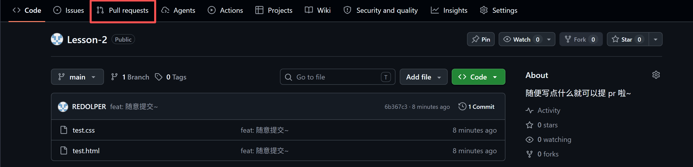
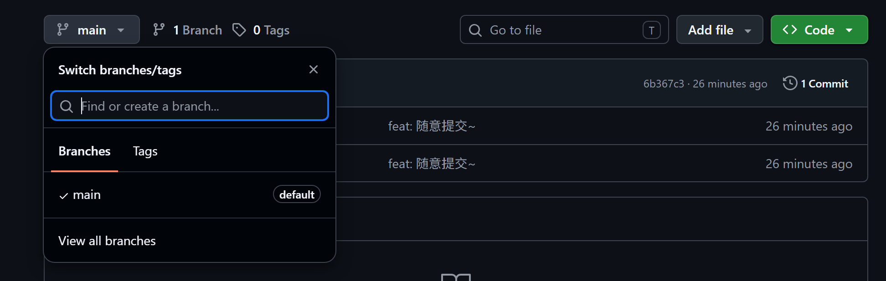
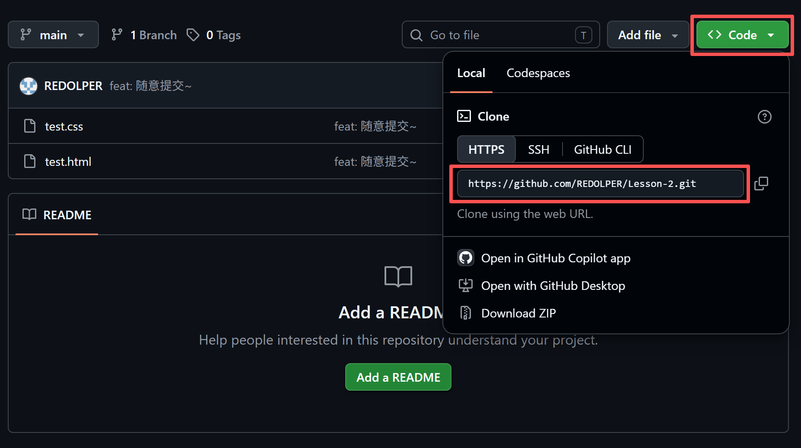
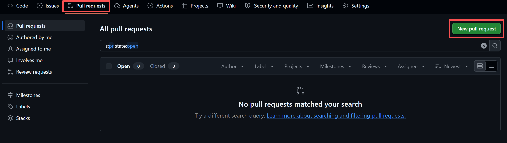
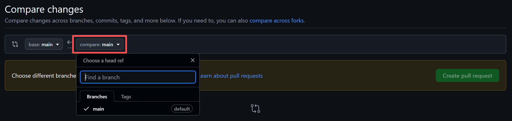

# Lv3

> 如果你没有提过 pr ，在写这个作业之前，请务必看一下这个文档哦~

## pr 简介

首先，让我来解释一下什么是 pr —— pr ，全称 pull request ，是 github, gitlab 等平台一个用于 **合并** 的功能。

在 github 中，它在这个地方……



那么可能有同学就有疑问了：既然可以使用 `git merge` 来合并，为什么还需要这种 提 pr 的方式 来合并呀？

大致原因有以下三点：

- pr 有强制的代码审查：对于 `git merge` ，合并可以瞬间完成；但是 pr 会暂停流程，要求至少一位其他开发者审查代码。
- pr 可以触发一系列 **自动化检查** ，这有利于保证团队的代码质量（不通过审查的代码无法进行合并）
- pr 允许 开发者 / 审查者 对代码进行讨论（行内评论，决策记录）

因此，如果是小型的项目（比如个人项目），你可以随便使用 `git merge` 。但如果是大型项目（比如企业级的），则强烈建议（或者甚至是必须）使用提 pr 的方式合并。

## 提 pr 的方式

那么，我们该怎么提 pr 呢？有以下步骤……

1. 在这个仓库下新建一个自己的分支（一般都取名为 dev-xxx （xxx 为自己姓名拼音的首字母））（基于最新更新的分支（作业中就基于 main 分支就好啦~））

  

2. 克隆这个仓库到本地（使用 `git clone` 命令）

  

  在这个作业中就是在文件夹下的终端里执行这个 `git clone https://github.com/REDOLPER/Lesson-2.git` 命令啦~

3. 在本地切换到自己的分支上（使用 `git switch` 命令）
4. 随便加一点自己的东西（可以尝试装饰一下这个页面）

  > 注意！在提交之前（即下一个步骤之前），你需要检查一下本地的代码是不是最新的，需要执行 `git fetch origin && git status -sb`
  > 如果没有 behind 字样就是最新的，如果有的话就要同步一下
  > 同步需要执行以下命令……
  > ```
  > git stash push -m "本地修改"
  > git pull --rebase origin <你的分支名>
  > git stash pop
  > ```
  > 大致意思就是 暂存本地代码 -> 拉取最新代码 -> 取出暂存的代码
  > 这时候大概会有 **冲突提示** ，因为这个文件没有明显的分区，大家容易在同一个位置修改。此时你需要保留双方更改，再继续提交。
  > （当然，你也可以不执行这些操作，这样提交的 pr 就不能直接合并，这时候就需要人为解决冲突。不过，人为解决冲突是什么样呢？其实我也没有试过，你也可以给我出一道手动解决冲突的题哈哈哈）

5. 提交代码（提交信息记得加上自己的姓名哦）
6. 提 pr ，在这里……

  

  进到这个页面……

  

  compare 的分支需要改成自己的分支，意思就是 从 dev-xxx 合并到 main 。

1. 最后提交 pr 就可以啦！（如果没有冲突的话可以直接合并哦，即出现 can be automatically merge 等字样记得直接合并上去哦）

以上步骤只是一个简单的流程，在做大项目时步骤会比这个要复杂很多，比如：需要填写审查者、需要跑自动化流程（CICD）等等，这中间也可能出现很多问题。不过，这个作业只是希望大家能熟悉一下提 pr 这个流程，大家以后项目做多了自然就熟悉啦~！😊
