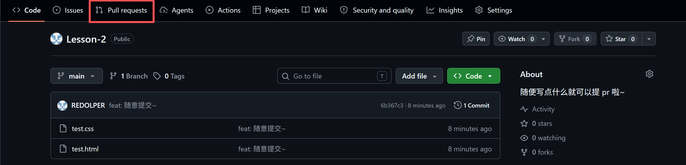
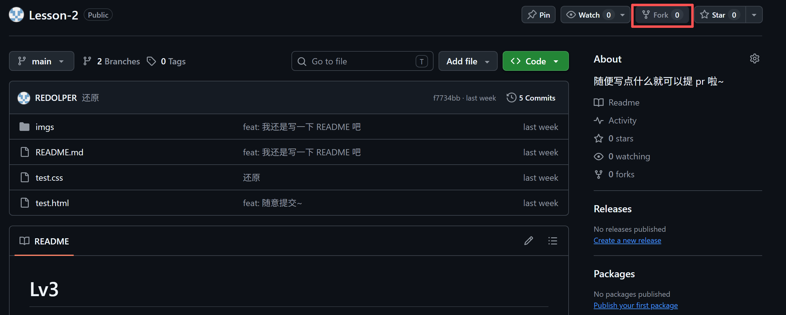
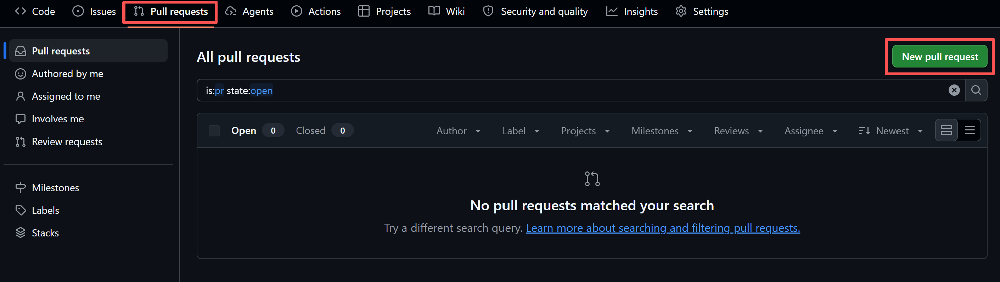
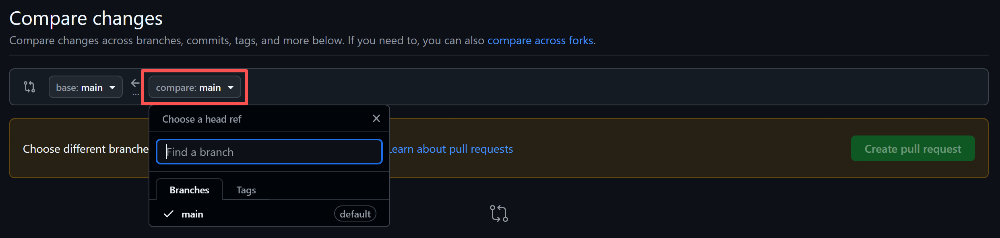

# Lv3

> 如果你没有提过 pr ，在写这个作业之前，请务必看一下这个文档哦~

## pr 简介

首先，让我来解释一下什么是 pr —— pr ，全称 pull request ，是 github, gitlab 等平台一个用于 **合并** 的功能。

在 github 中，它在这个地方……

那么可能有同学就有疑问了：既然可以使用 `git merge` 来合并，为什么还需要这种 提 pr 的方式 来合并呀？

大致原因有以下三点：

- pr 有强制的代码审查：对于 `git merge` ，合并可以瞬间完成；但是 pr 会暂停流程，要求至少一位其他开发者审查代码。
- pr 可以触发一系列 **自动化检查** ，这有利于保证团队的代码质量（不通过审查的代码无法进行合并）
- pr 允许 开发者 / 审查者 对代码进行讨论（行内评论，决策记录）

因此，如果是小型的项目（比如个人项目），你可以随便使用 `git merge` 。但如果是大型项目（比如企业级的），则强烈建议（或者甚至是必须）使用提 pr 的方式合并。

## 提 pr 的方式

那么，我们该怎么提 pr 呢？有以下步骤……

1. fork 这个仓库到自己的账号下

  

2. 随便加一点自己的东西（可以尝试装饰一下这个页面）
3. 提交代码（提交信息记得加上自己的姓名哦）
4. 提 pr ，在这里……

  

  进到这个页面……

  

  这里大概保持默认即可，意思是 从 克隆的 xxx 分支 合并到 原仓库下的 xxx 分支 。

5. 最后提交 pr 就可以啦！（此时 pr 会是 Open 的状态，因为仓库的所有权在我这里，因此需要我这里手动合并哦）

以上步骤只是一个简单的流程，在做大项目时步骤会比这个要复杂很多，比如：需要填写审查者、需要跑自动化流程（CICD）等等，这中间也可能出现很多问题。不过，这个作业只是希望大家能熟悉一下提 pr 这个流程（对于其他人的仓库），大家以后项目做多了自然就熟悉啦~！😊
